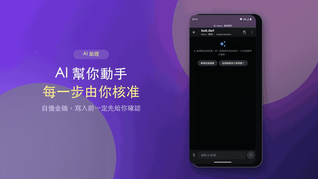
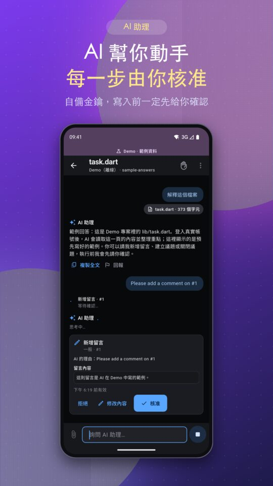
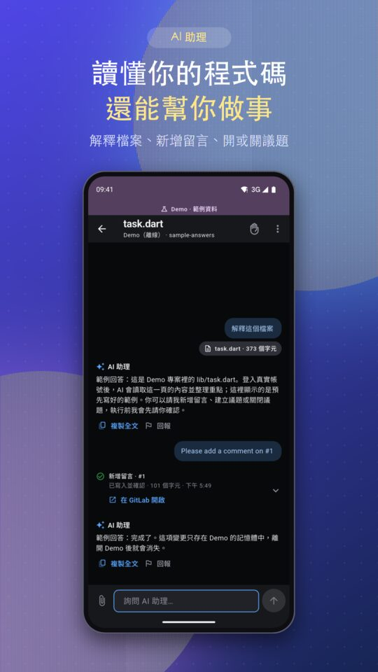
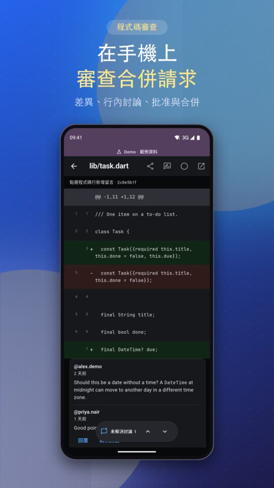
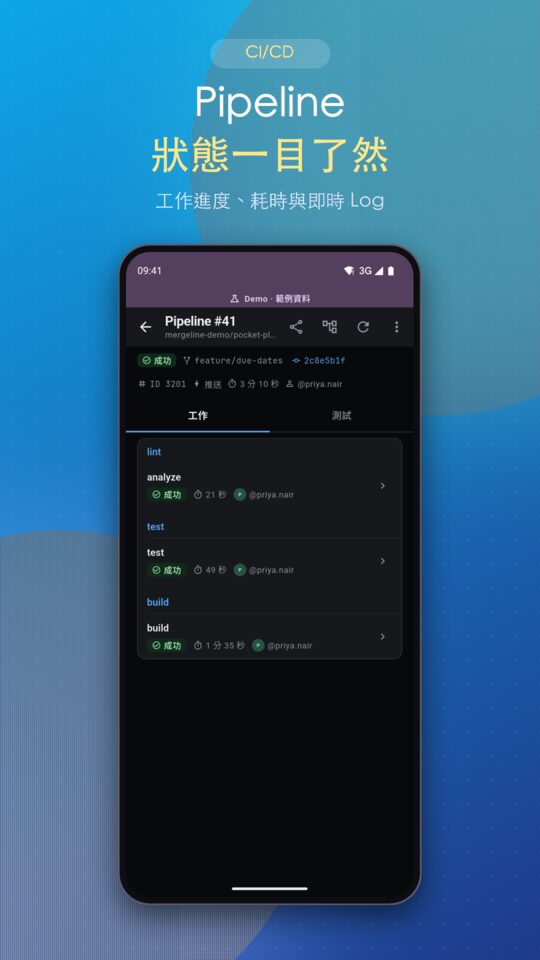
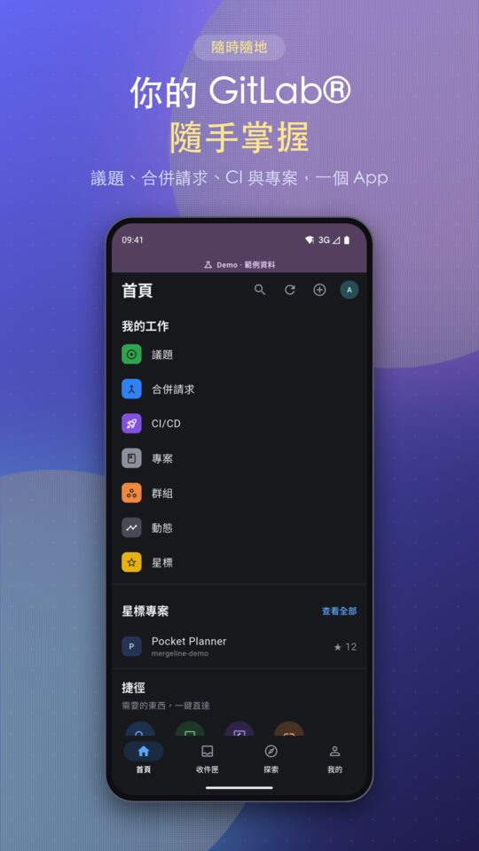

# Mergeline

<p align="center">
  
</p>

**GitLab®, in your pocket.** Mergeline is a mobile-first client for GitLab.com and self-managed GitLab: issues, merge-request review and merge, CI/CD pipelines and logs, files and an inbox — plus a **bring-your-own-key AI assistant** that explains code and proposes changes, each one confirmed by you.

- ▶️ **Demo video:** [youtube.com/watch?v=p-G6da2prmg](https://www.youtube.com/watch?v=p-G6da2prmg)
- 📦 **Android (GitLab channel, free):** [latest release](https://gitlab.com/aa22396584/gitlab-mobile/-/releases) — installed builds update themselves under 我的 › 應用程式更新
- 🛒 **Google Play (`app.mergeline`, US$3.99):** under review
- 🧪 **Try without an account:** tap **試用 Demo** on the sign-in screen

> Canonical repository, issues and merge requests: https://gitlab.com/aa22396584/gitlab-mobile.
> Independent third-party software, not affiliated with or endorsed by GitLab Inc. GITLAB is a trademark of GitLab Inc.

<p align="center">
  
</p>

## Screenshots

| AI proposes, you approve | Understands your code | Review merge requests | CI/CD at a glance | Your GitLab, at hand |
|---|---|---|---|---|
|  |  |  |  |  |

All screenshots and the video show **Demo mode** with sample data.

## Features

- **Work from your phone:** projects, files and Markdown (images, tap-to-load audio and video), issues and work items, merge requests with diffs, inline discussions, approvals and merge, pipelines with jobs and live logs, releases, labels, milestones, snippets, wiki and more.
- **Inbox:** todos, review requests, mentions and assignments, with swipe-to-done.
- **AI assistant (bring your own key):** OpenAI-compatible Chat Completions, OpenAI Responses and Anthropic Messages. The assistant reads the page you are on and, when needed, more of the same project; it can propose any write the app itself can do.
  - Every write shows a **confirmation card** first; high-risk writes need you to type the name; each write is read back.
  - Secrets are masked before anything leaves the device; sensitive files are withheld.
  - Report an AI answer from inside the app (回報).
- **Accounts and privacy:** GitLab.com and HTTPS self-managed instances, several accounts, PAT sign-in, an app lock, encrypted drafts and optional encrypted AI history. No developer server, no analytics, no ads — see the [privacy policy](docs/PRIVACY.md).
- **Offline reading:** an encrypted read cache and offline repository copies.
- **24 languages**, light/dark appearance, dynamic colour and large text.

## Supported GitLab versions

The app needs **GitLab 18.11** or later (GitLab.com or HTTPS self-managed instances). Older instances stay readable where possible, but some screens report `unsupported` instead of loading. Work-item comment writes, including AI-assisted writes, need GitLab 18.9+, which the minimum covers. One exception: the work-item development row's closing-merge-requests count needs GitLab 19.4 and shows as unavailable below that.

## Documentation

- [Changelog](CHANGELOG.md) — what changed in each release.
- [Documentation index](docs/README.md) — plans and status, privacy, store listing, CI, signing, verification ledgers and audits.
- [Plan and status](docs/PLAN_STATUS.md) — what is being built, in what order, and where each piece stands.

## Verification

See [current mobile parity and performance](docs/MOBILE_PARITY_PERFORMANCE.md), [v0.5 verification](docs/V0_5_VERIFICATION.md), [v0.3 verification](docs/V0_3_VERIFICATION.md), [v0.2 verification](docs/V0_2_VERIFICATION.md) and [mobile UX changes](docs/UI_REDESIGN.md). CI executes the actual Dart/Flutter code. Synthetic transport tests, live server checks, emulator runs and physical-device runs stay distinct. On `9183f19`, pipeline `2869335026` reported `509` tests in its JUnit report. That is the observed count for that pipeline.

A real GitLab `Link` header expanded omitted `false` defaults and caused the original project-list failure. The parser now validates immutable scope, preserves the caller's query, and extracts only a safe pagination cursor. Valid first-page data is no longer rejected because GitLab expanded defaults.

## Build and CI

Pinned Flutter **3.47.2** / Dart **3.13.2**; committed `pubspec.lock`. Normal pipelines enforce the lock, run analysis and unit/widget tests, capture actual Flutter-rendered synthetic-data screenshots, generate/check Android/iOS templates, then build an Android debug APK. Only successful `main` pipelines publish commit-addressed preview packages using `CI_JOB_TOKEN`.

```sh
./.fvm/flutter_sdk/bin/flutter pub get --enforce-lockfile
./.fvm/flutter_sdk/bin/flutter analyze --no-pub
./.fvm/flutter_sdk/bin/flutter test --no-pub
python3 tool/bootstrap.py
python3 tool/android_signing.py configure android/app/build.gradle.kts
./.fvm/flutter_sdk/bin/flutter build apk --debug --flavor gitlab
```

Launcher icon: `assets/icon/*.png` are rendered from the vector design in `tool/render_icon.py` (`python3 tool/render_icon.py --chromium <chromium or headless_shell>`); `tool/bootstrap.py` and `ci/build_android.sh` turn them into platform icon sets with `flutter_launcher_icons`. Edit the script, not the PNGs.

Screenshots: `flutter_checks` job artifacts → `ci-output/screenshots/`. They are real Flutter host-rendered screens with synthetic data, not an Android/iOS device run or a generated design mock-up. Android APKs: `android_debug` artifacts; main previews: project Package Registry. Local debug, profile and release APKs use the stable development signer described in [Android local signing](docs/ANDROID_SIGNING.md). Published CI previews from `main` and release tags are **release** builds of the `gitlab` flavor, signed by a separate stable CI identity held in a protected CI variable (see [CI](docs/CI.md#android-signing-lanes)); merge-request builds are debug builds signed with a discarded ephemeral key. Neither path is a store-signed release.

## Live CRUD smoke

`tool/live_smoke.dart` uses the production Dart API client and a unique, isolated **private** project. It validates the expected account, performs read-after-write checks and cleans up only its exact synthetic project. Credentials are read from a runtime file; never commit a PAT or use a Dart compile-time define for one.

The `live_crud_smoke` job runs only in an explicit API-triggered pipeline with `LIVE_SMOKE=1`. The credential must be supplied through a secure mechanism approved for the execution environment. Do not bypass that boundary. The normal APK does not include a test PAT.

A production-client run on 2026-09-21/22 is recorded in the [v0.3 ledger](docs/V0_3_VERIFICATION.md): **33 PASS / 1 FAIL** against an isolated private GitLab.com project. The failure is shared-runner quota (`ci_quota_exceeded`), not a client defect, and the check is still FAIL. `smoke-output/report.json` is not committed. Pipeline retry / cancel / delete did not run in that execution. The smoke was not re-run after the merges.

## Historical specifications

`docs/plan/` preserves the original 105-operation design and acceptance plan. It is a **target specification**, not proof that every operation has been implemented or verified. Earlier G0/R1 documents and package manifests are historical handoffs; the current Git history, CI results, and the v0.2 and v0.3 verification ledgers supersede their status statements.

## License

GNU Affero General Public License v3.0 (AGPL-3.0). Copyright (C) 2026 ImL1s. See [LICENSE](LICENSE).
